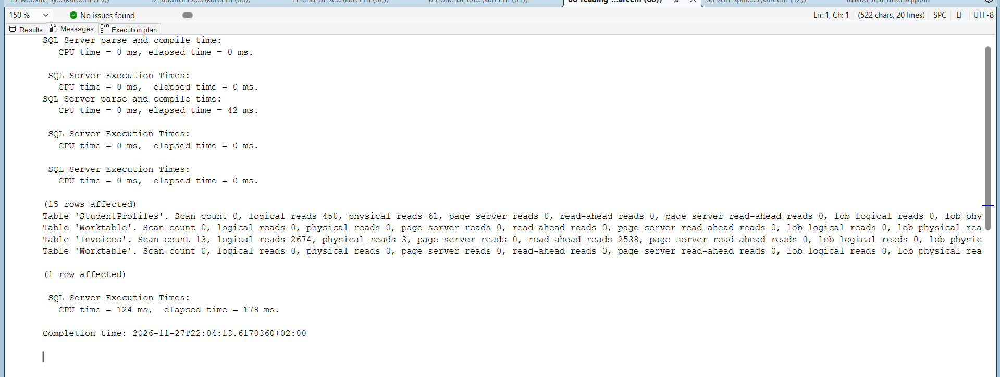
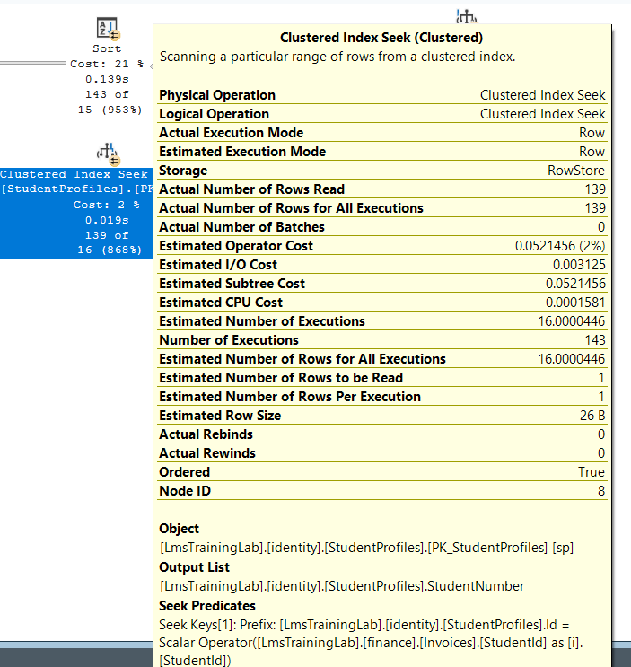

## Task 6

Prediction: SELECT <= HASH JOIN <= SORT<= CLUSTERED INDEX SCAN

The query returned 15 rows. It used 124 ms of CPU and took 178 ms to run. Parsing and compilation took 42 ms.

Invoices had 13 scan starts, 2,674 logical reads, 3 physical reads, and 2,538 read-ahead reads. StudentProfiles had a scan count of 0, with 450 logical reads, 61 physical reads, and 0 read-ahead reads. Both worktables reported zero reads.

### Operators:

Clustered Index Scan: Scanned the invoice index because the filters check the due date and compare two amounts. It read 146,801 rows and passed 50,427, against 43,532 estimated. The scan had no required order.

Compute Scalar: Calculated `TotalAmount - PaidAmount` as `Expr1002` so the next step could sort by the balance.

Sort: Ordered each worker’s rows by `Expr1002 DESC` so the largest balances came first.

Nested Loops: Passed each candidate invoice’s `StudentId` to the student lookup. That ID is the outer reference.

Clustered Index Seek: Used `sp.Id = i.StudentId` to find the student by primary key and return `StudentNumber`.

Gather Streams: Combined the workers’ results and kept them in balance order for Top.

Top: Took the first 15 rows. The expression is a fixed count.

Compute Scalar (Urgency): Used the due date to label the final rows `Urgent` or `Normal`.

SELECT: Returned the result. The plan shows 12 parallel workers, a 14 MB memory grant, and a 56 KB cached plan.

